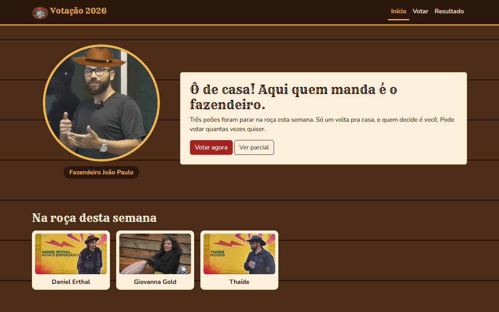
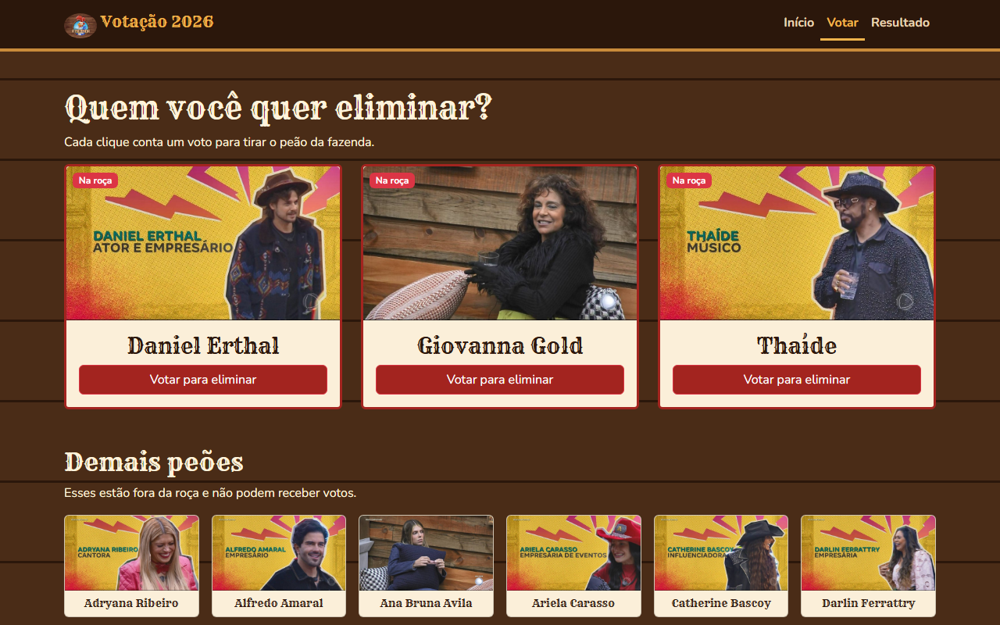
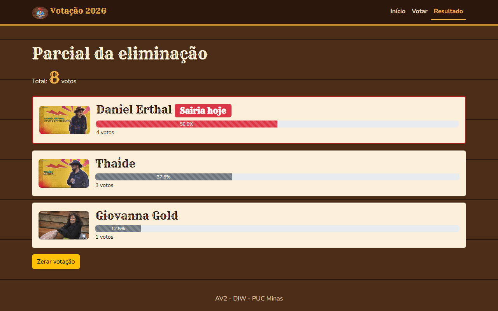
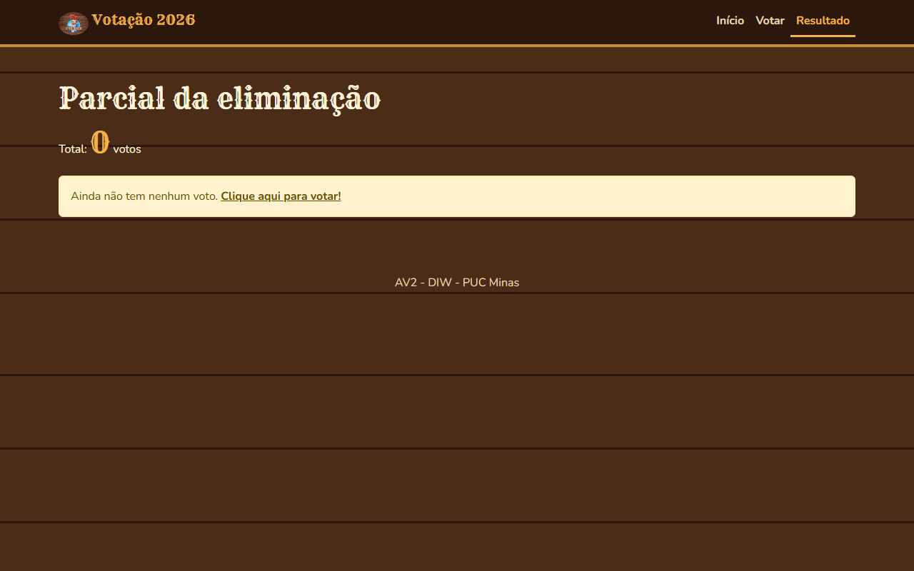

# Votação A Fazenda 2026

Projeto da AV2 de Desenvolvimento de Interfaces Web (DIW) - Ciência da Computação, PUC Minas.

É um site de votação para a eliminação de A Fazenda 2026. Dá pra ver quem está na roça, votar em quem deve sair e acompanhar a parcial com o total de votos e a porcentagem de cada participante. Os votos ficam salvos no `db.json` através do JSON Server.

Feito com HTML, CSS, JavaScript, Bootstrap 5 e JSON Server.

## Telas

### Início


### Votação


### Resultado


### Resultado sem votos


## Como rodar

Precisa ter o Node.js instalado.

```
npm install
npm start
```

Depois é só abrir http://localhost:3000/ no navegador.

O `npm start` roda o `json-server --watch db.json --port 3000`, que cria a API a partir do `db.json` e também serve os arquivos da pasta `public`.

## Estrutura

```
VotacaoFazenda
├── db.json            participantes e votos
├── package.json
└── public
    ├── index.html     página inicial
    ├── votacao.html   cards para votar
    ├── resultado.html parcial com as barras de progresso
    ├── css/style.css  tema (fontes, cores e fundo)
    ├── js/api.js      funções com fetch
    ├── js/home.js
    ├── js/votacao.js
    ├── js/resultado.js
    ├── lib/bootstrap
    ├── fonts
    └── img
```

## Rotas usadas

| Método | Rota | Para que |
|---|---|---|
| GET | `/participantes?naRoca=true` | Pegar os 3 que estão na roça |
| GET | `/participantes?naRoca=false` | Pegar os demais peões |
| GET | `/votos` | Contar os votos |
| POST | `/votos` | Registrar um voto |
| DELETE | `/votos/:id` | Apagar os votos (Zerar votação) |

Cada voto é salvo assim:

```json
{ "id": 1, "participanteId": 25, "data": "2026-11-10T12:00:00.000Z" }
```

## Bootstrap

- Navbar responsiva com `navbar-expand-md`, `navbar-toggler` e `collapse`
- Grid com `container`, `row`, `col-md-*` e `row-cols-*`
- Cards para os participantes
- Badges "Na roça" e "Sairia hoje"
- Alert de voto registrado
- Progress bar no resultado
- Modal para confirmar antes de zerar a votação

## Autor

Davi Campolina Rocha
